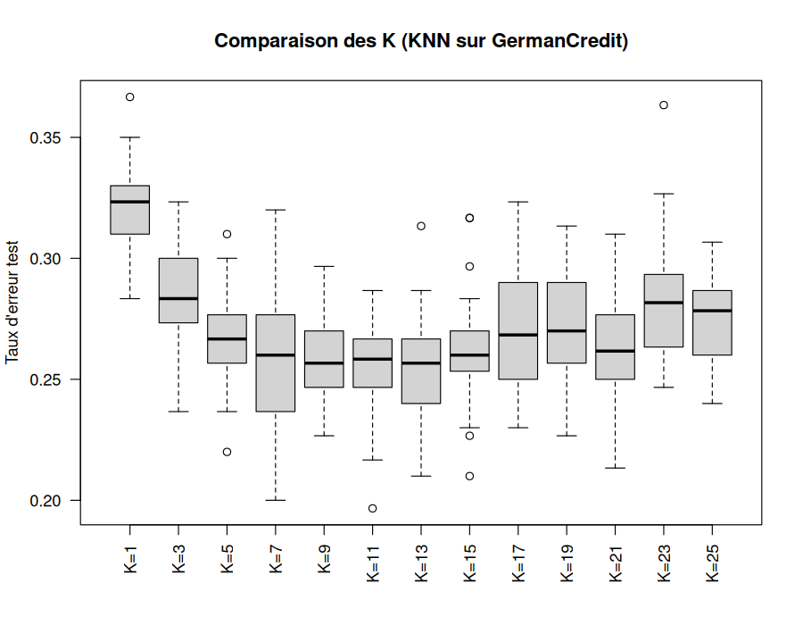
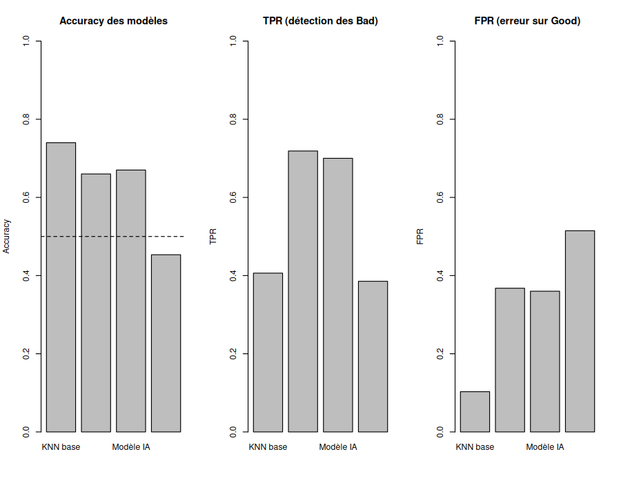
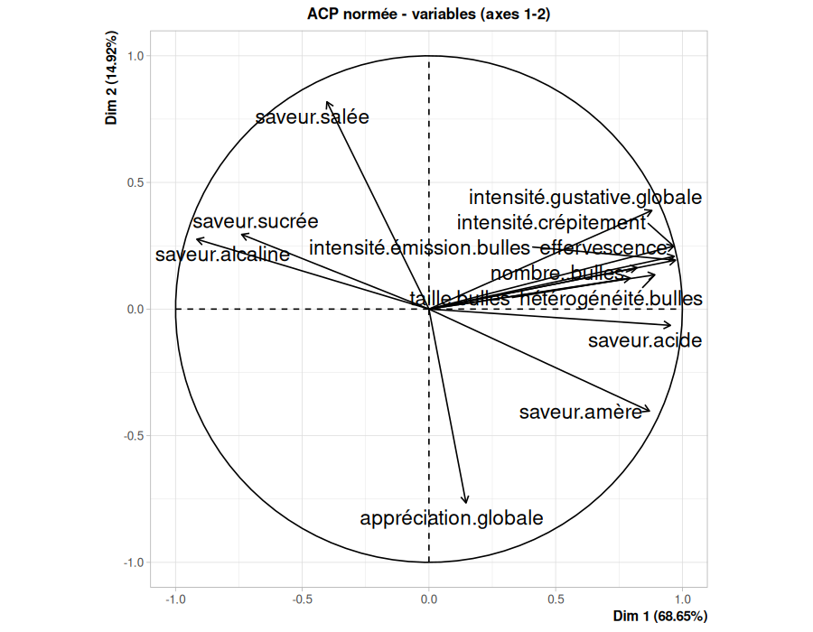
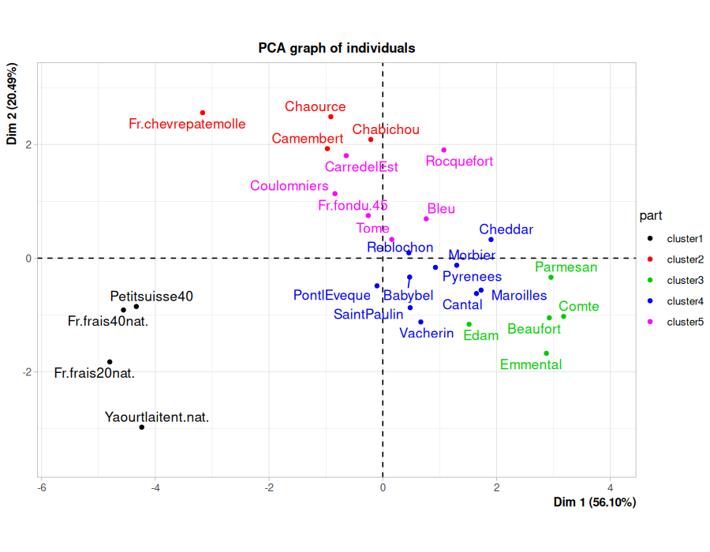
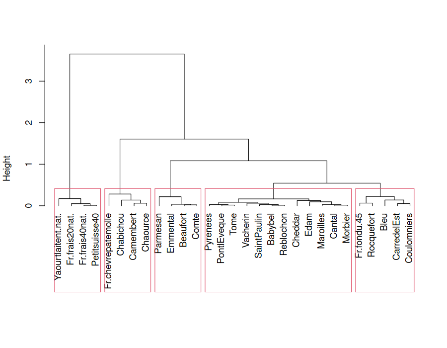
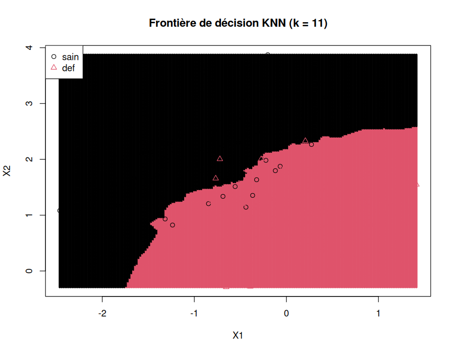

# Data Analysis in R

Exploratory and predictive data analysis in R: PCA, k-means and hierarchical clustering, MCA, KNN, logistic regression and a credit-scoring case study on the German Credit dataset.

Coursework from the data analysis course at ENSEIRB-MATMECA (2025). Each folder is a self-contained analysis with its script, its data (when redistributable) and the figures it produces. Code comments and plot labels are in French.

## Analyses

| Folder | Topic | Methods |
|---|---|---|
| [`german-credit/`](german-credit) | Credit scoring: predict "Bad" vs "Good" borrowers | KNN with k tuned over 30 train/test splits, decision threshold tuning, ROC/AUC, FAMD + KNN, PyTorch MLP baseline |
| [`pca/`](pca) | Sensory profiles of 8 sparkling mineral waters | Covariance vs correlation PCA, eigen-decomposition by hand, Kaiser criterion, cos2 |
| [`clustering/`](clustering) | Nutritional profiles of 29 cheeses, qualitative profiles of 27 dog breeds | k-means, Ward hierarchical clustering, Ward-initialised k-means, `catdes`, MCA + Ward |
| [`supervised-classification/`](supervised-classification) | Synthetic two-class problem (healthy vs failing companies) | KNN vs logistic regression, decision boundaries, repeated train/test error, confusion matrix, ROC/AUC |
| [`descriptive-statistics/`](descriptive-statistics) | R basics and descriptive statistics on a nutrition survey | Data frames, factors/ordered factors, bar charts, boxplots, histograms |

### German Credit: credit scoring

KNN on 6 borrower features (3 numeric, 3 categorical). Test error over 30 random 70/30 splits for each odd k, which leads to k = 13:



The data are imbalanced (70% "Good"), so the default 0.5 threshold misses most risky borrowers (TPR 0.41). Lowering the threshold on P(Bad) to 0.28 raises TPR to 0.72 for FPR 0.37, about the same as a small PyTorch MLP trained with a class-weighted loss ([`credit_mlp.ipynb`](german-credit/credit_mlp.ipynb)). Test AUC is 0.74.



`famd_knn.R` takes another approach: it projects the mixed variables with FAMD (factor analysis of mixed data) and runs KNN on the first 5 components (AUC 0.71).

### PCA: mineral waters

Correlation circle of the normed PCA. The first axis (69% of the variance) contrasts strongly sparkling, intense waters with sweet/alkaline ones. Overall liking mostly follows axis 2.



### Clustering: cheeses and dog breeds

k-means (K = 5, 50 random starts) on standardised nutritional data, shown on the first PCA plane. The partition explains 77% of the inertia and differs by only 2 cheeses from the Ward dendrogram cut into 5 classes (Ward alone: 76.5%):




For qualitative data (dog breeds), the categorical variables are first recoded with MCA, then clustered with Ward. The clusters are described with `catdes`.

### Supervised classification: KNN vs logistic regression

KNN gives a non-linear decision boundary and logistic regression gives a linear one. KNN test error is estimated over 50 random train/test splits, and logistic regression is evaluated with a confusion matrix and ROC/AUC (AUC ≈ 0.99 on this synthetic dataset).



### Descriptive statistics

Introductory R: subsetting, data frames, factors and ordered factors, and univariate summaries of a nutrition survey of 226 elderly people. The datasets are not included (see [Data](#data)).

## Tech stack

- R 4.x: `FactoMineR` (PCA, MCA, FAMD, `catdes`), `caret` (`knn3`, `confusionMatrix`), `ROCR`, `MASS`, `RColorBrewer`, base graphics
- Python 3 (German Credit MLP only): PyTorch, scikit-learn, pandas

## Getting started

```bash
# R packages
Rscript -e 'install.packages(c("FactoMineR", "caret", "ROCR", "RColorBrewer"), repos = "https://cloud.r-project.org")'

# run an analysis from its own folder (paths are relative)
cd clustering
Rscript clustering_cheeses_dogs.R
```

The scripts were written to be run interactively in RStudio, step by step. With `Rscript`, base graphics go to `Rplots.pdf`. The figures in `figures/` were rendered by sourcing each script with a `png()` device open and `print.eval = TRUE`.

> Recent FactoMineR releases (≥ 2.12) depend on `showtext`/`sysfonts`, which need the FreeType system headers. Without them, `install.packages("https://cloud.r-project.org/src/contrib/Archive/FactoMineR/FactoMineR_2.11.tar.gz", repos = NULL, type = "source")` works.

German Credit MLP notebook:

```bash
python3 -m venv .venv && source .venv/bin/activate
pip install -r german-credit/requirements.txt
cd german-credit && jupyter notebook credit_mlp.ipynb
```

## Data

| Dataset | Used in | Source |
|---|---|---|
| `german-credit/data/GermanCredit.*` | german-credit | Subset (7 of 21 attributes, recoded) of the [Statlog (German Credit Data)](https://archive.ics.uci.edu/dataset/144/statlog+german+credit+data) dataset, Hans Hofmann, UCI Machine Learning Repository, CC BY 4.0 |
| `pca/data/mineral_waters.rda` | pca | Sensory evaluation of 8 mineral waters, a classic dataset from French multivariate statistics teaching material |
| `clustering/data/cheeses.txt` | clustering | Nutritional composition of 29 cheeses, a classic dataset from French multivariate statistics teaching material |
| `clustering/data/dogs.rda` | clustering | 27 dog breeds described by 6 qualitative variables, a classic MCA example from the French data analysis literature |
| `supervised-classification/data/synth.rda` | supervised-classification | Synthetic data (300 simulated companies) |
| `nutriage.txt`, `Intima_Media.txt` | descriptive-statistics | **Not included.** These are course-provided health and nutrition survey data whose redistribution terms could not be verified. `nutriage` is a nutrition survey of elderly people used in *Statistiques avec R* (Cornillon et al., PUR). To run the script, place both files in `descriptive-statistics/`. |
